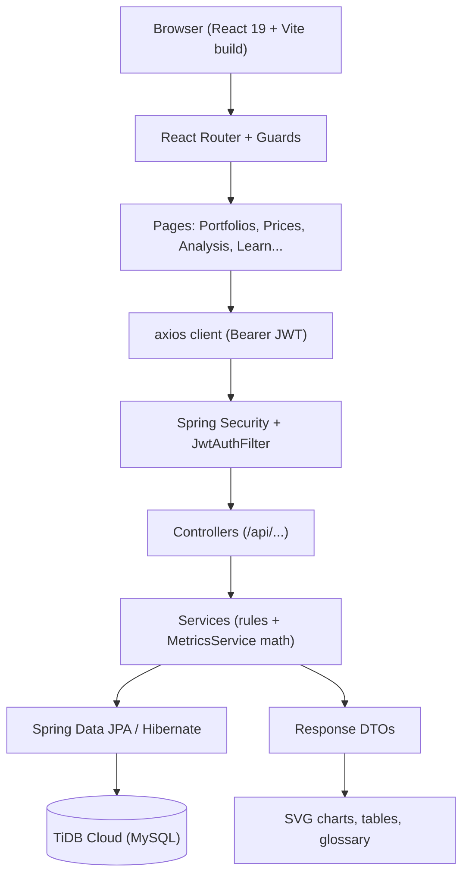

<div align="center">

# PortfolioPilot

**Quantitative portfolio risk, return, and diversification analysis — full system.**


**[Live application](https://portfolio-pilot-frontend-pi.vercel.app)** ·
[Frontend repo](https://github.com/shb09/portfolio-pilot-frontend) ·
[Backend repo](https://github.com/shb09/portfolio-pilot-backend)

*Live demo: open the app, register in seconds, and press **Load Interactive Demo** —
explore real analytics on simulated prices, no market data needed.*

[Features](#features) · [Quickstart](#quickstart) ·
[Architecture](#architecture) · [Docs](./docs/PRD.md)

</div>

A web-based quantitative-finance application: manage investment portfolios, import
historical prices through validated CSV files, compute valuation and financial risk
metrics, and explore interactive performance dashboards with benchmark comparisons.

**Historical analysis only — not a trading platform.** No broker orders, no forecasts.

## Contents

- [Live deployments](#live-deployments)
- [Features](#features)
- [Quickstart](#quickstart)
- [Architecture](#architecture)
- [Repository structure](#repository-structure)
- [Local development](#local-development)
- [Environment configuration](#environment-configuration)
- [Testing](#testing)
- [Deployment overview](#deployment-overview)
- [Limitations and future improvements](#limitations-and-future-improvements)

## Live deployments

| | |
|---|---|
| **Live frontend** | [https://portfolio-pilot-frontend-pi.vercel.app](https://portfolio-pilot-frontend-pi.vercel.app) |
| **Backend API** | [https://portfolio-pilot-api-0e01.onrender.com](https://portfolio-pilot-api-0e01.onrender.com) |
| **Frontend repo (deployment source)** | [https://github.com/shb09/portfolio-pilot-frontend](https://github.com/shb09/portfolio-pilot-frontend) |
| **Backend repo (deployment source)** | [https://github.com/shb09/portfolio-pilot-backend](https://github.com/shb09/portfolio-pilot-backend) |
| **This monorepo (full history)** | [https://github.com/shb09/portfolio-pilot](https://github.com/shb09/portfolio-pilot) |

Deployment runs from the **split repositories**, not from this monorepo: Vercel builds
the frontend split's `main`, Render builds the backend split's `main` (Docker). This
monorepo carries the complete history and both applications for unified development.

## Features

- **Auth** — immediate-login registration, username-or-email login, verify/resend,
  forgot/reset, Google OIDC when configured, JWT sessions, admin role.
- **Portfolios & holdings** — named portfolios with benchmark symbols; positions with
  positive quantities; duplicate symbols rejected.
- **CSV price import** — `date,symbol,close` validation, per-row errors, duplicate-safe
  re-imports (unique per user/symbol/date).
- **Financial engine** — valuation, allocation/HHI, simple/cumulative/annualized returns
  (252-day), sample volatility, Sharpe at zero risk-free rate, max drawdown, aligned-window
  benchmark comparison (active return, tracking error), plottable value series, optional
  date windows. Missing metrics return reasons, never NaN.
- **Interactive frontend** — performance/drawdown charts, date ranges, benchmark editing,
  holdings search/sort, CSV exports, one-click idempotent demo, guided walkthrough,
  searchable glossary sharing one definition source with every inline help icon.
- **Learning-first UX** — first-visit tour, contextual term explanations with live
  interpretations, simulated-data disclosure wherever demo data appears.
- **Security** — BCrypt hashes, owner-scoped queries (cross-user → 404), rate-limited
  resend/forgot, 5-minute single-use OAuth handoff codes.

| Area | Frontend (`frontend/`) | Backend (`backend/`) |
|---|---|---|
| Auth | Login/Register/OAuth pages, `AuthContext` | `AuthController`, `VerificationService`, JWT + Google OIDC |
| Portfolios | Portfolios/detail pages | `FinPortfolioController` + service, `fin_portfolios` |
| Prices | Import page + report | `PriceController` + validation, `asset_prices` |
| Analytics | Charts, ranges, exports | `AnalysisController`, `MetricsService` engine |
| Learning | Glossary, tour, walkthrough | — (content lives client-side) |

## Quickstart

```bash
# backend (:8080) — JDK 21, TiDB/MySQL reachable
cd backend
export JAVA_HOME=/Library/Java/JavaVirtualMachines/jdk-21.jdk/Contents/Home  # macOS example
export TIDB_URL='jdbc:mysql://<host>:4000/<db>?sslMode=VERIFY_IDENTITY&serverTimezone=UTC'
export TIDB_USER='<user>' TIDB_PASSWORD='<password>' JWT_SECRET='<≥64 chars>'
APP_AUTH_DEV_MODE=true mvn spring-boot:run
curl http://localhost:8080/api/health   # {"status":"OK",...}

# frontend (:5173) — dev proxy forwards /api to :8080, no env file needed
cd frontend
npm install
npm run dev
```

Then register at `http://localhost:5173`, press **Load Interactive Demo**, and explore
analysis, benchmark comparison, and Learn.

## Architecture



- **Frontend** (`frontend/`): React 19, Vite 8, Tailwind 4, React Router 7, axios,
  Framer Motion (menus/dialogs only), Lucide; dependency-free SVG charts.
- **Backend** (`backend/`): Java 21, Spring Boot 3.2.5, Security (JWT + Google OIDC),
  Data JPA/Hibernate, Validation, Mail, JJWT, BCrypt, Maven.
- **Database** (`TiDB Cloud`): users, fin_portfolios, holdings, asset_prices
  (unique per user/symbol/date), plus legacy career tables; `ddl-auto=update`.
- **Deployments**: Vercel (frontend split) + Render Docker (backend split).

## Repository structure

```text
├── README.md                  # this file
├── backend/                   # Spring Boot API (mirrors the backend split)
│   ├── pom.xml / Dockerfile / render.yaml
│   ├── docs/                  # PRD, API/flow/architecture/DB/deployment/security notes
│   └── src/ (controller, service, dto, entity, repository, security, config)
├── frontend/                  # React client (mirrors the frontend split)
│   ├── index.html / vite.config.js / public/ (incl. demo/ simulated CSVs)
│   └── src/ (App, api, auth, theme, config, data/glossary, components, pages)
└── docs/                      # demo-data guide + product/deployment docs
```

The splits preserve this history; day-to-day content is identical apart from
deployment-owned extras (e.g. split-only ambient components, per-repo docs).

## Local development

- Backend and frontend run as above; frontend dev needs no env file (proxy handles `/api`).
- Production-like frontend check: `npm run build` + `npm run preview` inside `frontend/`
  with `VITE_API_URL` set.
- Port discipline: frontend `:5173` strict, backend `:8080`; stop duplicates instead of
  hopping ports.

## Environment configuration

- Frontend (build-time, public): `VITE_API_URL` (bare backend origin; required in
  production builds), optional `VITE_PUBLIC_URL`. Never secrets.
- Backend (server-only): `TIDB_URL/USER/PASSWORD`, `JWT_SECRET`,
  `APP_BASE_URL`, `APP_CORS_ALLOWED_ORIGINS`, `GOOGLE_OAUTH_CLIENT_ID/SECRET`
  (absent = password-only), `SPRING_MAIL_*` (absent = mail disabled),
  `APP_ADMIN_*` bootstrap, `PORT`. Full details in each split README.

## Testing

- Backend: `mvn test` (JUnit 5 + Mockito) — 56 tests across 11 classes, all passing at
  last verification; covers auth flows, ownership isolation, metrics math, CSV
  validation, OAuth handoff, and windowed analysis.
- Frontend: `npm run lint` (oxlint, 0 errors) and `npm run build` (Vite) inside
  `frontend/`; no frontend test runner is configured.
- Manual E2E regularly exercised: registration/login (password + Google-enabled
  button), idempotent demo setup, analysis math vs API, cross-user 404s, mobile and
  keyboard passes.

## Deployment overview

- **Frontend:** Vercel auto-deploys the frontend split's `main`; set `VITE_API_URL` in
  project env and rebuild on change.
- **Backend:** Render builds the backend split's `main` via `Dockerfile`
  (Maven + Temurin 21 → JRE 21); health check `GET /api/health`; free plan sleeps after
  idle (first request can take ~a minute).
- **Database:** TiDB Cloud, credentials only in host dashboards — never in Git.

## Limitations and future improvements

Historical analysis only: metrics depend on imported CSV quality, demo prices are
simulated, no broker execution, past performance implies nothing about the future,
short-window annualized figures are indicative. Schema evolves via Hibernate (no
versioned migrations); free-tier hosting sleeps; rate limits are in-memory.
Ideas: versioned migrations, refresh-token rotation, live market-data connectors, more
benchmark presets, client test automation.
